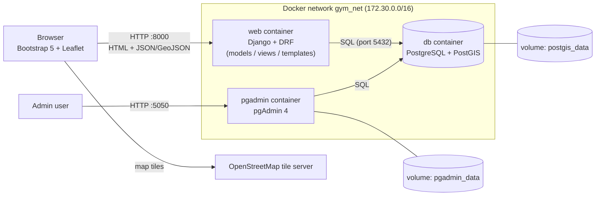
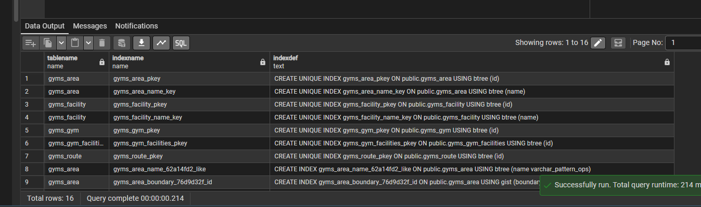
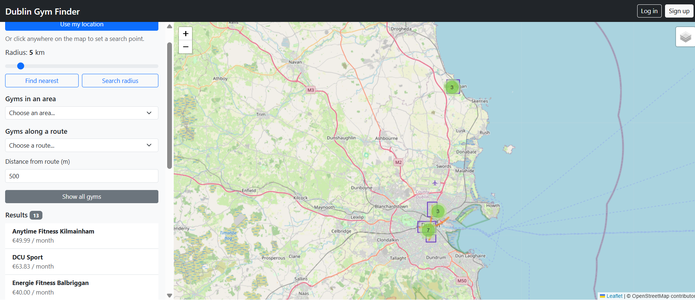
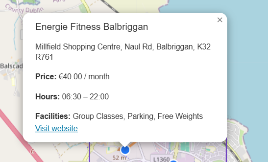
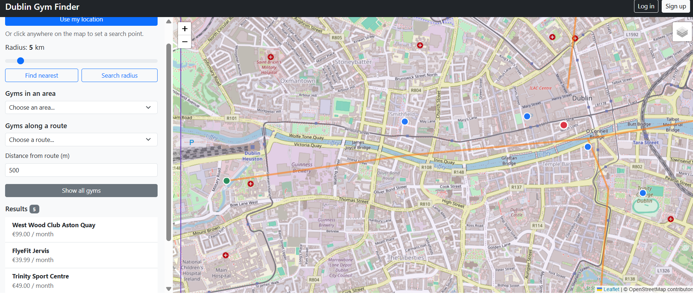
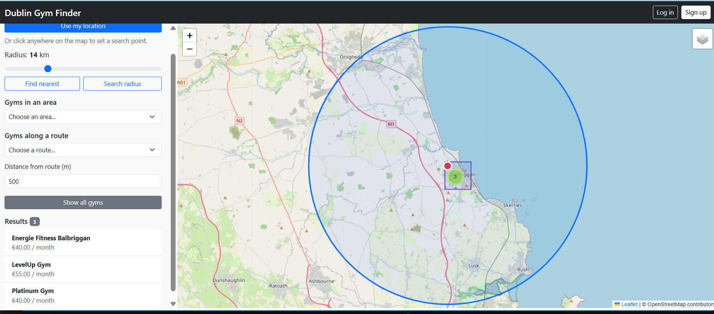
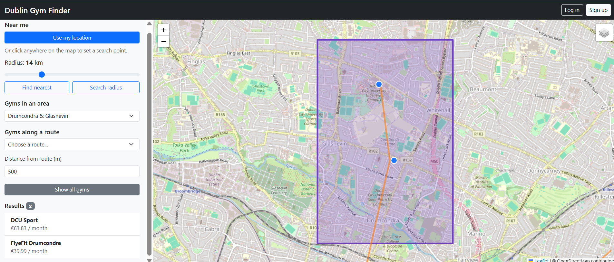
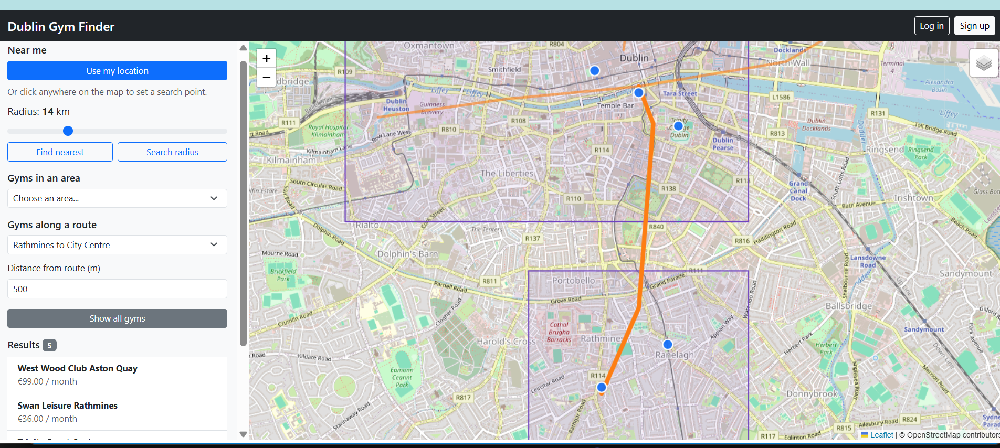
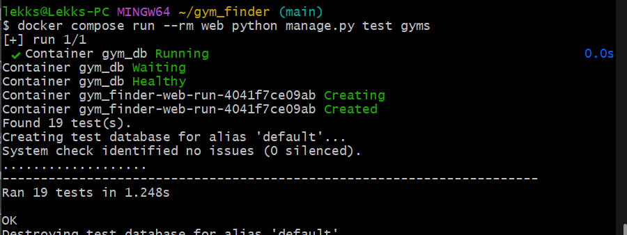

# Dublin Gym Finder
What this web application does is that it finds the closest gym to a users location . It also allows the user to register and login. The web app allows user to search for a gym within a radius of minimum 1km and a maximum of 50 km with a default of km. They can choose from a list of areas and along a specific route.

## Features

**Radius search** with an adjustable slider (1–50 km)
**User accounts** with sign up and login; only admins can edit gyms, and only a route's owner can edit it
**Gyms in an area**: pick a neighbourhood and see only the gyms inside it
**Nearest gyms** to your location (browser geolocation) or any point you click on the map
**Gym popups** showing address, monthly price, opening hours, facilities and website
**Interactive map** of Dublin gyms (Leaflet + OpenStreetMap) with clustered markers

## Tech Stack

**Database:** PostgreSQL 16 + PostGIS 3.4 (managed with pgAdmin 4)
**Backend:** Django 5, Django REST Framework, djangorestframework-gis
**Frontend:** Bootstrap 5, Leaflet 1.9, Leaflet.markercluster
**Map tiles:** OpenStreetMap
**Deployment:** Docker + Docker Compose (3 containers)

## Setup 

**Requirements:** Docker Desktop and Git.
## Setup

**Requirements:** Docker Desktop and Git.

1. Clone the repo
   ```bash
   git clone https://github.com/lekkszzy/gym-finder.git
   cd gym-finder
   ```
2. Create your environment file and fill in your own values
   ```bash
   cp .env.example .env
   ```
3. Build and start the containers
   ```bash
   docker compose up --build -d
   ```
4. Create the database tables
   ```bash
   docker compose run --rm web python manage.py migrate
   ```
5. Create an admin user (do this before step 6, since the sample routes belong to user 1)
   ```bash
   docker compose run --rm web python manage.py createsuperuser
   ```
6. Load the sample data (13 gyms, 4 areas, 4 routes, 5 facilities)
   ```bash
   docker compose run --rm web python manage.py loaddata sample_data
   ```
7. Open the app at **http://localhost:8000/** 

**Run the tests**
```bash
docker compose run --rm web python manage.py test gyms
```
## Test Credentials

## Test Credentials

| Role | Username | Password | Can do |
|---|---|---|---|
| Admin | `lekks` | `TestPassword` | Everything |
| Normal user | `sign up createyourown` | `sign up createyourown` | View and search their own routes |

These accounts exist on the demo machine. On a fresh install, create an admin with `createsuperuser` (Setup step 5) and a normal user with **Sign up**.

pgAdmin's login is set in `.env` (`PGADMIN_DEFAULT_EMAIL` / `PGADMIN_DEFAULT_PASSWORD`). To connect to the database, register a server with host `db`, port `5432`.

## User Guide

## User Guide

1. **Browse:**   Open the map with all gyms (blue markers for gyms, green = open 24/7), . Click a marker for its details, or click a gym in the results list to zoom to it.
2. **Nearest gyms:** click **Use my location** (allow location access) or click anywhere on the map, then **Find nearest**.
3. **Radius search:** set a point as above, drag the radius slider, then click **Search radius**. The circle shows the search area.
4. **Gyms in an area:** choose an area from the dropdown to see only the gyms inside it.
5. **Gyms along a route:** choose a route, and change the distance from the route (in metres) if you like.
6. **Layers:** use the layer button (top right of the map) to show or hide gyms, areas and routes.
7. **Reset:** click **Show all gyms**  To see every gym again.

## API
All spatial data is returned as GeoJSON. Anyone can read; writing requires a login. 
Writing needs a login (see permissions below)

Column 1	Column 2
Endpoint	What it does
/api/gyms/	List gyms (GET) or add one (POST, admin)
/api/gyms/<id>/	View, edit or delete a gym (edit/delete: admin)
/api/areas/ and /api/areas/<id>/	List, add, view, edit or delete areas (changes: admin)
/api/routes/ and /api/routes/<id>/	List or add routes (logged in); edit/delete your own route only
/api/facilities/ and /api/facilities/<id>/	List, add, view, edit or delete facilities (changes: admin)
/api/gyms/nearest/?lat=&lng=&limit=5	Nearest gyms to a point, closest first
/api/gyms/within-radius/?lat=&lng=&radius_km=5	Gyms within a radius (km)
/api/areas/<id>/gyms/	Gyms inside an area (containment)
/api/routes/<id>/gyms/?buffer_m=500	Gyms within a distance (m) of a route (buffer)
List endpoints also support ?search= (e.g. ?search=pool) and ?ordering= (e.g. ?ordering=monthly_price).

Errors: 400 for missing or invalid values (lat/lng must be in Ireland), 403 if you don’t have permission, 404 if the area or route doesn’t exist.

## Architecture




## Database Schema

## Database Schema

| Model | Geometry | Key fields |
|---|---|---|
| `Gym` | Point (`location`) | name, address, monthly_price, is_24_hours_open, opening_time, closing_time, website, facilities (many-to-many → Facility) |
| `Area` | Polygon (`boundary`) | name (unique) |
| `Route` | LineString (`path`) | name, owner (foreign key → User) |
| `Facility` | — | name (unique), description |

All geometry fields use **SRID 4326** (WGS 84 lat/lng), and Django creates a **GiST spatial index** on every geometry column. Migrations are in `gyms/migrations/`.


## Screenshots

### Main map


### Gym details popup


### Nearest gyms


### Radius search


### Gyms in an area (containment)


### Gyms along a route (buffer)


### Mobile view


### Tests


## Known Limitations
**Ireland only:** Searches outside Ireland (lat 51–56, lng −11 to −5) are rejected.
**Sample data:** Gym names and approximate locations are real; prices and hours come from gym websites where published, otherwise they're estimates.

## Acknowledgements
Structure adapted from my own Advanced Web Mapping **Labs 3–6** (Docker setup, settings, views, Leaflet map, tests).
**Claude (Anthropic)** was used for code review and debugging, as permitted by the lecturer. It also helped write the API tests, the search, area and route features in `map.js`, the login/sign-up templates , all of which I reviewed, tested and adapted.
`IsOwnerOrReadOnly` / `ReadOnly` permissions and `perform_create` adapted from the **Django REST Framework** documentation.
- `GeoFeatureModelSerializer` and `GeoJsonPagination` from the **djangorestframework-gis** documentation.